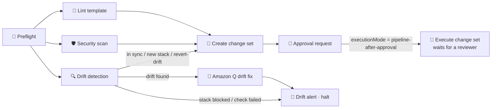
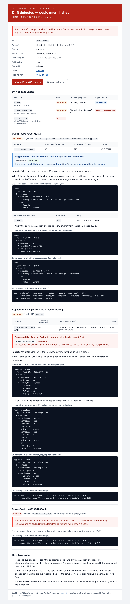
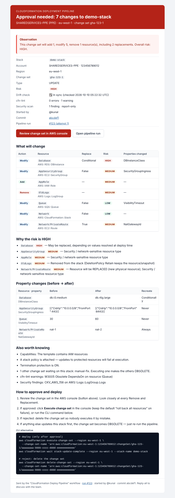
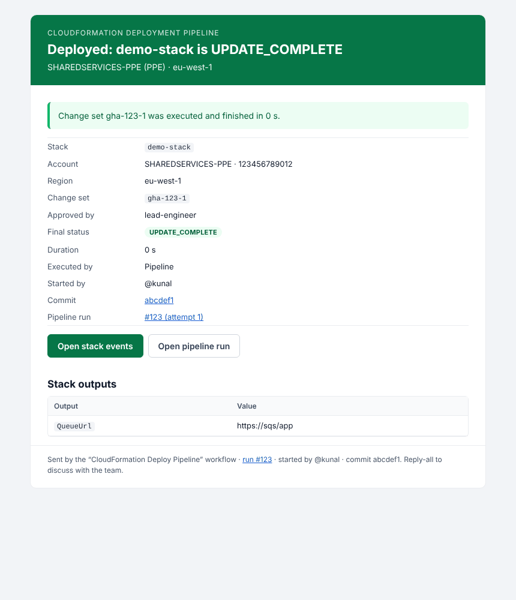
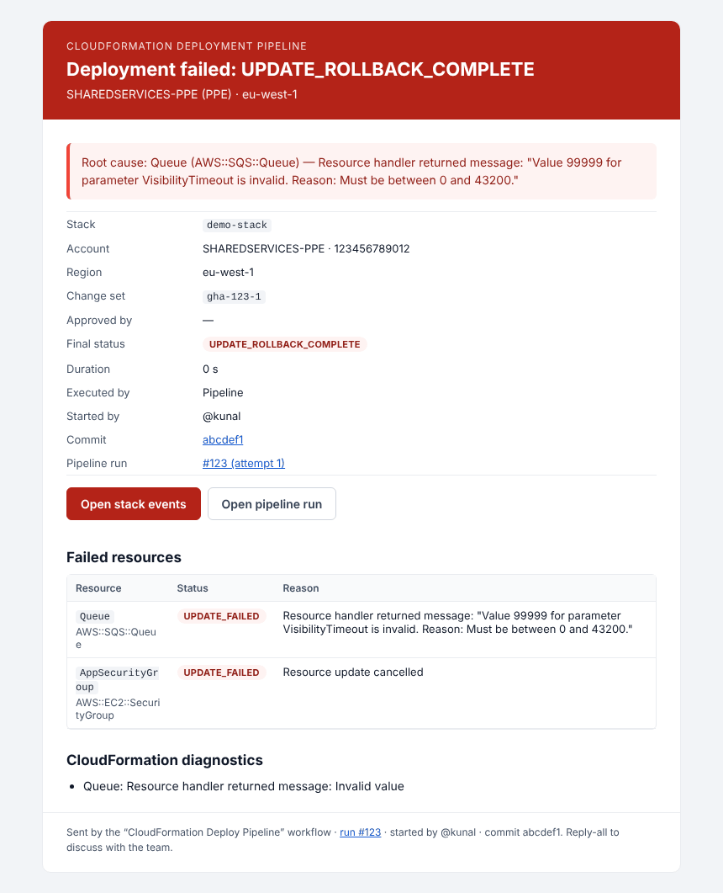
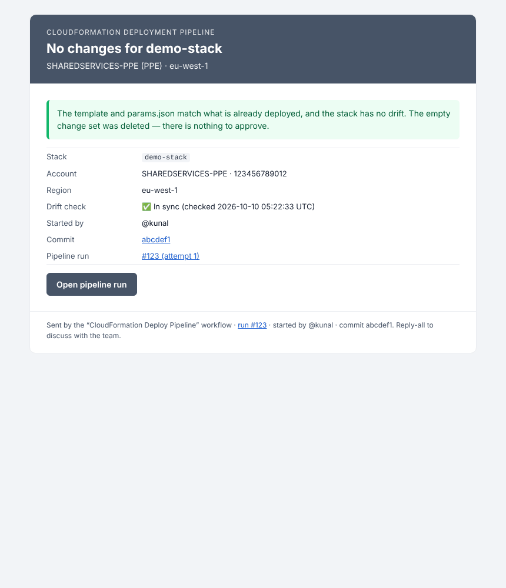

# CloudFormation Deploy Pipeline

A manual GitHub Actions pipeline that never deploys blind. It does the following, in order:

1. Validates the template.
2. Checks the stack for drift. If anything was changed outside CloudFormation, it stops and emails a drift report with the live YAML and an Amazon Q suggested fix.
3. Creates a change set and emails an observation to the approvers.
4. Hands execution to a human, either in the AWS console or through a GitHub approval gate.

It replaces `latest_cft_deployment.yml`. Both can run side by side while you try it out.

---

## What you see when it runs

Each stage is a separate job, so the run page shows the familiar graph: boxes spin while running, turn **green** when they pass, **red** when they stop the run, and **grey** when skipped.



| Box | What it does | Stops the run when… |
|---|---|---|
| 🧭 **Preflight** | Checks the inputs. Finds the single `*-template.yaml` and its `params.json`. Checks every parameter against the template (unknown keys, missing values, AllowedValues, Min/Max). Maps the account alias to its role secret. Reports which email / Amazon Q options are configured. | input, file or parameter problems; deploy-role secret missing |
| 🧹 **Lint template** | `cfn-lint` for your region. Findings are annotated on the exact template line. | any lint **error** (warnings are only reported) |
| 🛡️ **Security scan** | Checkov CloudFormation checks. | never by default (report-only); set `CFN_SECURITY_SCAN_BLOCKING=true` to block |
| 🔍 **Drift detection** | Checks the stack status, then runs drift detection on the stack **and every nested stack**. For each drifted resource it captures the property diff, the live YAML, the resource's code from the repo, and the full live config from Cloud Control API. | never itself; it sets the gate for the next boxes |
| 🤖 **Amazon Q drift fix** | Only runs when drift is found. Asks Amazon Q Developer (Kiro CLI, headless) or Amazon Bedrock to rewrite each drifted resource's YAML to match live, keeping your `!Ref`/`!Sub`/parameters. Also recommends whether to *adopt* or *revert* the change. | never (advisory) |
| 🚨 **Drift alert · halt** | Emails the drift report (diffs, live YAML, suggested code, CloudTrail "who changed it" command), then fails the run on purpose. | always (that is its job) |
| 📝 **Create change set** | Stages large templates in S3 exactly like before, then creates the change set (CREATE/UPDATE, or drift-aware `REVERT_DRIFT`). It surfaces CloudFormation's pre-deployment validation errors and warnings, and rates every change LOW/MEDIUM/HIGH. "No changes" is a clean, green outcome. | the change set fails validation |
| 📧 **Approval request** | Emails the *observation*: what will change, why the risk is what it is, before→after values, lint/security results, and exactly how to approve, execute or reject. | — |
| 🚀 **Execute change set** | Optional, and grey unless `executionMode = pipeline-after-approval`. It waits for a GitHub reviewer, verifies the approval really happened, re-checks drift, executes, streams stack events, and emails the result with the root cause on failure. | deployment fails / new drift / change set obsolete |

Every box also writes a **job summary** (click the box), and the reports are uploaded as run artifacts (`*-report`, `email-*`).

---

## Running it

**Actions → CloudFormation Deploy Pipeline → Run workflow**

| Input | Meaning |
|---|---|
| `folderPath` | Folder under `cloudformation/` holding exactly one `*-template.yaml` and a `params.json` (same convention as before). |
| `stackName` | Stack to create or update. |
| `roleAlias` | **Dropdown** of target accounts (maps to the existing role secrets). |
| `AWS_REGION` | Defaults to `eu-west-1`. |
| `driftPolicy` | `block` (default): drift stops the run and emails the report. `revert-drift`: continue with a **drift-aware change set** that puts live resources back to the template values when executed. |
| `executionMode` | `manual-console` (default): the run ends after the approval email; an approver executes the change set in the console. `pipeline-after-approval`: the run waits at 🚀 until a reviewer approves in GitHub, then deploys. |

### Typical outcomes

| Situation | Graph | Email |
|---|---|---|
| Stack in sync, changes found | all green up to 📧 (🚀 grey or waiting) | **Approval needed** |
| Template already deployed | all green | **No changes** |
| Someone changed resources in the console | 🔍 green → 🤖 green → 🚨 **red**; change set boxes grey | **Drift detected — deployment halted** |
| New stack | drift check skipped (green), CREATE change set | **Approval needed** |
| Stack stuck in `UPDATE_ROLLBACK_FAILED`, `ROLLBACK_COMPLETE`, … | 🚨 red | **Deployment blocked** with the exact recovery command |

Only one run per stack can be active at a time. A second run for the same stack queues instead of racing.

---

## One-time setup

### 1. Copy the files into the repository

```
.github/workflows/cfn-deploy-pipeline.yml      the pipeline
.github/actions/setup-cfn-pipeline/            Python setup used by every box
.github/cfn-pipeline/                          scripts, config, tests, docs (this file)
cloudformation/cfn-pipeline-support/           IAM role/policy for email + Bedrock (deploy once)
cloudformation/examples/drift-demo/            optional demo stack to see drift handling end to end
```

Raise a PR and merge it as usual. The workflow shows up under **Actions** once it is on the default branch.

### 2. Secrets

*Settings → Secrets and variables → Actions → Secrets*

| Secret | Status | Purpose |
|---|---|---|
| `NETWORK_SERVICES_ROLE` … `CRV_ROLE` | **existing, unchanged** | Deploy role per account (see `config/accounts.json`). |
| `S3_ACCESS_GITHUB_ROLE` | **existing, unchanged** | Large-template staging through `presign.py`. |
| `CFN_PIPELINE_SERVICES_ROLE` | new | Role used to send emails (SES/SNS) and call Bedrock — output of the support stack. |
| `KIRO_API_KEY` | new, optional | Amazon Q Developer / Kiro CLI headless key for the drift-fix box. |

The pipeline still runs without the two new secrets. Emails are skipped, and the drift report still includes the live YAML.

### 3. Deploy the support stack (email + Bedrock permissions)

Edit `cloudformation/cfn-pipeline-support/params.json`:

| Parameter | Value |
|---|---|
| `GitHubOidcProviderArn` | the existing GitHub OIDC provider in that account (*IAM → Identity providers*) |
| `GitHubOidcHost` | `token.actions.tescoims.ghe.com` (GHE.com) or `token.actions.githubusercontent.com` |
| `GitHubSubjectPatterns` | this repo, e.g. `repo:plat-eng/AWS-Landing-Zone:*`. Repos created after GitHub's immutable-subject change also need their immutable-ID pattern. Values are comma-separated. |
| `SenderEmailAddress` | the From address (must be a verified SES identity) |
| `CreateRole` | `false` + `ExistingRoleName` if your landing zone creates roles centrally — the template then only creates the managed policy and attaches it |

Then run the pipeline itself: `folderPath = cfn-pipeline-support`, `stackName = cfn-pipeline-support`, `roleAlias = SHAREDSERVICES` (or wherever SES lives). Execute the change set, and put the `PipelineServicesRoleArn` output into the `CFN_PIPELINE_SERVICES_ROLE` secret.

### 4. Repository variables

*Settings → Secrets and variables → Actions → Variables*. All are optional except the two mail addresses if you want email.

| Variable | Default | Purpose |
|---|---|---|
| `CFN_MAIL_FROM` | — | Verified SES sender, e.g. `CFN Pipeline <cfn-pipeline@yourdomain>` |
| `CFN_MAIL_TO` | — | Approvers, comma-separated (a distribution list works best) |
| `CFN_MAIL_CC` | — | Optional CC |
| `CFN_MAIL_SUBJECT_PREFIX` | — | e.g. `[Platform]` |
| `CFN_NOTIFY_CHANNEL` | `ses` | `ses` (HTML + attachments), `sns` (plain text to a topic), `none` |
| `CFN_SNS_TOPIC_ARN` | — | Needed only for `sns` |
| `CFN_SERVICES_REGION` | `eu-west-1` | Region for SES/SNS/Bedrock |
| `CFN_AI_PROVIDER` | `auto` | `auto` (Kiro if `KIRO_API_KEY` is set, else Bedrock), `kiro`, `bedrock`, `none` |
| `CFN_BEDROCK_MODEL_ID` | `eu.anthropic.claude-sonnet-5-5` | Bedrock model / inference profile (EU profile keeps prompts in EU regions) |
| `CFN_KIRO_MODEL` | — | Optional model id for Kiro CLI |
| `CFN_APPROVAL_ENVIRONMENT` | `cfn-change-approval` | GitHub environment used by 🚀 |
| `CFN_SECURITY_SCAN_BLOCKING` | `false` | `true` makes Checkov findings stop the run |
| `CFN_BLOCK_SELF_APPROVAL` | `false` | `true` fails 🚀 if the approver also started the run |

### 5. Email through Amazon SES

* Verify the sender in SES (same account/region as the support stack): a **domain** identity (Easy DKIM CNAMEs in Route 53) or the single address (`CreateSenderIdentity=true` sends a verification link).
* A new SES account is in the **sandbox** and can only send to verified addresses. Either verify each recipient or request production access (*SES → Account dashboard*).
* The email is also saved as an artifact (`email-drift`, `email-approval`, `email-result`). You can preview it even while sending is off.

### 6. Amazon Q integration (optional, recommended)

Amazon Q Developer CLI is now **Kiro CLI**, and Q Developer Pro subscriptions carry over. Since Kiro CLI 2.0 it has a **headless mode** for CI/CD that authenticates with an API key.

1. API keys are available on Kiro Pro, Pro+, Pro Max and Power plans. If your subscription is managed through IAM Identity Center, an admin first enables **API keys** in the Kiro settings.
2. Sign in at **app.kiro.dev** with your organisation's IAM Identity Center → *Account → API keys → create*. Copy it once.
3. Save it as the repository secret **`KIRO_API_KEY`** and leave `CFN_AI_PROVIDER=auto`.

The 🤖 box installs the CLI (`curl -fsSL https://cli.kiro.dev/install | bash`) and runs
`kiro-cli chat --no-interactive --trust-tools=read,grep`, so it can only read files.

**No Kiro subscription?** Leave `KIRO_API_KEY` empty. The same box uses **Amazon Bedrock** (Claude Sonnet 5.5 through the EU inference profile) with the `CFN_PIPELINE_SERVICES_ROLE`. With both configured, Kiro is tried first and Bedrock is the fallback for each resource. The email states which one produced each suggestion.

Bedrock notes:
* Anthropic models may need a one-time use-case form per account. Have an admin open the model once in the Bedrock console playground.
* The EU profile routes requests to several EU regions. If an SCP denies regions outside your landing-zone list, allow `bedrock:InvokeModel*` there, or switch `CFN_BEDROCK_MODEL_ID`.

**What is sent to the AI:** the drifted resource's diff, its live properties, its code from the template, the `Parameters` section and the `params.json` values. `NoEcho` values are masked as `****`. Values under secret-looking keys (`*Password*`, `*Secret*`, `*Token*`, Name/Value pairs like `DB_PASSWORD`) are replaced with `***REDACTED***` before anything leaves the runner.

### 7. GitHub approval gate (only for `pipeline-after-approval`)

*Settings → Environments → New environment* `cfn-change-approval`:

* **Required reviewers**: the approvers or team. Tick **Prevent self-review**.
* *Deployment branches*: restrict to the default branch if you like.

The 🚀 box also calls the GitHub API and **refuses to deploy unless an approval is recorded**. A misconfigured environment can't silently skip the gate.

> **OIDC note.** A job that uses an environment gets the subject `repo:<org>/<repo>:environment:cfn-change-approval` instead of `…:ref:refs/heads/main`. Trust policies that use `repo:<org>/*` (as in `ims-root/iam-roles`) already match. Any role that pins `ref:refs/heads/main` needs the environment form added.

### 8. Permissions the existing deploy roles need

Most deploy roles already have these. The new ones are drift detection, `DescribeEvents` and Cloud Control read:

```
cloudformation:DescribeStacks  ListStackResources  ValidateTemplate  GetStackPolicy  DescribeType
cloudformation:DetectStackDrift  DetectStackResourceDrift  DescribeStackDriftDetectionStatus  DescribeStackResourceDrifts
cloudformation:CreateChangeSet  DescribeChangeSet  ListChangeSets  DeleteChangeSet  ExecuteChangeSet
cloudformation:DescribeStackEvents  DescribeEvents
cloudcontrol:GetResource      + read/describe permissions for the resource types in your stacks
```

---

## The emails

| Drift alert | Approval request |
|---|---|
|  |  |

| Deployed | Failed | No changes |
|---|---|---|
|  |  |  |

Attachments:

* **Drift alert**: `drift-report.json`, `drifted-resources-live.yaml`, `suggested-code.yaml`, `suggested-fixes.md`.
* **Approval request**: `changes.csv` (handy for CAB records), `changeset.json`.
* **Result**: `execution-result.json`.

---

## How drift is handled

```
drift found ──► driftPolicy = block (default)
                 │  run stops, nothing changes in AWS, email has diff + live YAML + suggested code
                 │
                 ├─ keep the console change → paste the suggested code / params.json change → PR → merge → re-run
                 └─ undo the console change → re-run with driftPolicy = revert-drift
                                              → drift-aware change set (REVERT_DRIFT) → approval → execute
```

* **Live YAML** is generated directly from CloudFormation's drift result, so it is always there, AI or not. It shows the drift-tracked properties with resolved values.
* **Suggested code** is the AI's rewrite of *your* resource block. It keeps intrinsic functions and points out when a value should change in `params.json` instead of being hard-coded. Treat it as a reviewed suggestion, not an auto-commit.
* Drift-aware change sets use the CloudFormation feature from November 2025: a three-way comparison of template, last deployment and live state. Write-only properties, and the resource types AWS lists as unsupported, fall back to a normal comparison.
* Before executing, 🚀 runs drift detection again. If someone changed a resource while the run waited for approval, it stops instead of overwriting the change.

---

## Changes from the old pipeline

| Before (`latest_cft_deployment.yml`) | Now |
|---|---|
| One job, deploys immediately (`update-stack` / `deploy`) | Nine jobs; a change set is created and a person executes it |
| No drift check | Drift gate covering nested stacks, with report, live YAML and Amazon Q fix |
| `--parameters $param_args` broke on values with spaces or commas | Parameters go through boto3 unchanged |
| `${{ github.event.inputs.* }}` pasted into shell scripts (script-injection risk) | Inputs are passed as environment variables |
| `find … \| head -n 1` could pick a random template | Exactly one template per folder, or a clear error |
| Pre-signed URL printed with `curl -v` | URL masked and never printed |
| On failure, only `CREATE_FAILED` events were shown | All `*_FAILED` events incl. nested stacks, root cause, CloudFormation `DescribeEvents` diagnostics |
| `roleAlias` typed by hand | Dropdown |
| Node 20 action versions | `checkout@v6`, `configure-aws-credentials@v6`, `setup-python@v6`, `upload-artifact@v7`, `download-artifact@v8` |
| Deployments over 1 h lost their AWS session | 🚀 refreshes its OIDC credentials while it watches the stack |

---

## Try it with the drift demo

1. Run the pipeline with `folderPath = examples/drift-demo`, `stackName = cfn-pipeline-drift-demo`, `roleAlias = SANDBOX`. Execute the change set from the approval email.
2. In the SQS console, change the queue's *Visibility timeout* to 120 s (or the log group retention).
3. Run the pipeline again. 🔍 finds the drift, 🤖 writes the fix, and 🚨 emails it and stops.
4. Run again with `driftPolicy = revert-drift` to see a drift-aware change set put it back.
5. Delete the demo stack when done.

---

## Troubleshooting

| Symptom | Fix |
|---|---|
| Preflight: *secret … is empty or missing* | Add the deploy-role ARN secret named in the message. |
| Drift: **INCONCLUSIVE** | The deploy role cannot read one resource type, or the type doesn't support drift detection. Grant read access, or use `revert-drift` to review via a drift-aware change set. |
| *Email not sent — … not set* / *MessageRejected: Email address is not verified* | Set `CFN_MAIL_FROM`/`CFN_MAIL_TO`; verify the identity, or leave the SES sandbox. The preview is still in the `email-*` artifact. |
| 🤖: *AccessDeniedException* from Bedrock | Model not enabled in that account (open it once in the console), or an SCP blocks an EU region. |
| 🤖: *kiro-cli exited with code …* | Invalid or expired `KIRO_API_KEY`, or your plan has no API keys. Bedrock is used as fallback when configured. |
| 📝 fails with a validation table | That's CloudFormation's pre-deployment validation: the path and reason are in the job summary. Fix the template and re-run. |
| 🚀: *No reviewer approval is recorded* | Add Required reviewers to the `cfn-change-approval` environment. |
| 🚀: cannot assume the role | Add the `…:environment:cfn-change-approval` subject to the role's trust policy (see the OIDC note). |
| *Change set can no longer be executed (OBSOLETE)* | Something else updated the stack after the change set was made. Re-run the pipeline. |
| Run sits in *Queued* | Another run for the same stack is still active (or waiting for approval). |
| After fixing drift, the alert fires again | Use **Re-run all jobs** (or start a new run). *Re-run failed jobs* only repeats the alert box with the old report. |

---

## Tests

The scripts have unit and end-to-end tests that replay realistic AWS responses (no AWS account needed):

```bash
pip install pyyaml
cd .github/cfn-pipeline/tests && python -m unittest
```

`SAVE_SAMPLES=/tmp/emails python -m unittest test_end_to_end` writes the sample emails shown above.

## Adding an account

1. Add the alias to `.github/cfn-pipeline/config/accounts.json` (secret name + tier).
2. Add the same alias to the `roleAlias` options in `.github/workflows/cfn-deploy-pipeline.yml`.

A test checks that the two lists match.
